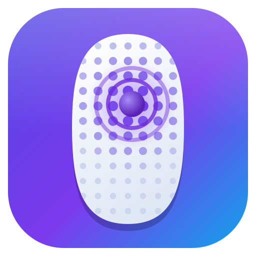

<p align="center"></p>

# MagicMouse Studio

A Windows app for the **Apple Magic Mouse 2** (Bluetooth): a live view of the touch sensor, battery level with
warnings, and gestures, scrolling and tap-to-click computed from the raw sensor data. It is written from scratch:
a small KMDF filter driver plus a Python / PySide6 tray app.

**English** · [Srpski](README.sr.md)

> Not affiliated with or endorsed by Apple Inc. "Magic Mouse" is a trademark of Apple Inc.
> The driver is **test-signed**, so it only loads when Windows Test Mode is on (see [Limitations](#limitations)).

## Features

- **Live sensor view:** every finger is shown as an ellipse with its contact size, angle and finger ID, plus a short trail.
  The view can be rotated or mirrored.
- **Battery:** shown as a percentage, with low-battery warnings, a "charged" notice and snooze.
  Windows never sees the battery level with Apple's driver alone.
- **Scrolling:** one or two fingers, smooth, inverted per axis, axis lock, acceleration and speed.
- **Clicks and taps:** middle click (several modes), tap-to-click with 1, 2 or 3 fingers, double-tap drag, left-handed mode.
- **Gestures:** swipe back/forward and two-finger swipe for virtual desktops or Task View.
- **Zones:** an editor for ignored edges, the tap area and the middle-button area.
- **Settings:** the same set as the Magic Utilities settings, with familiar defaults.
- **Languages:** English, Srpski, Español, Português (Brasil), Français, 中文（简体） and العربية (right-to-left).
- **Tray app:** autostart and a single-instance guard.
- **Installer:** installs the app and the driver; uninstalling removes both and leaves Apple's driver untouched.

## How it works

```
Magic Mouse 2 ──BT L2CAP──> BTHENUM HID node
                             ├─ HidBth (Windows)
                             ├─ applewirelessmouse (Apple Boot Camp driver: enables multi-touch, scrolling)
                             └─ mmsfilter.sys  (this project, lowest filter: only copies incoming packets)
                                     │  \\.\MagicMouseStudio  (IOCTL: READ_FRAME, GET_STATUS, SET_FEATURE)
                                     ▼
                             app (Python + PySide6): decodes 0x12 touch / 0x90 battery → view, battery, gestures
```

- The filter does not change any traffic. If you remove it, the mouse works exactly as before through Apple's driver.
- The mouse sends its battery level when it connects; the filter keeps that report for the app.
  Over the USB cable the battery is read directly through USB HID, with no driver needed.
- Gestures are applied with `SendInput` from a dedicated thread. A native low-level hook (`mmshook.dll`) swallows
  Apple's own wheel and click events only while a finger is on the Magic Mouse, so other mice are never affected.
- Protocol notes and the research behind the driver (in Serbian) are in [docs/RE-izvestaj.md](docs/RE-izvestaj.md).

## Requirements

- Windows 10 or 11 x64.
- Magic Mouse 2 paired over Bluetooth.
- Apple Boot Camp mouse driver (`applewirelessmouse`) installed. It switches the mouse into multi-touch mode.
- **Windows Test Mode** for the driver. Secure Boot must be off; run as administrator, then reboot:
  ```powershell
  bcdedit /set testsigning on
  ```

## Install

Download `MagicMouseStudio-Setup-<version>.exe` from [Releases](../../releases) and run it.

The installer offers to install the sensor driver. If it cannot, it tells you why:

| Code | Meaning |
|---|---|
| 10 | Test Mode is off; the driver was not installed |
| 11 | No paired Magic Mouse 2 was found |
| 12 | The Apple Boot Camp mouse driver is missing |

The app language is taken from the language you pick in the setup wizard.

Uninstall from Settings → Apps. This removes the app and the driver; user settings in
`%LOCALAPPDATA%\MagicMouseStudio` are kept.

## Run from source

```powershell
cd app
py -3.14 -m venv .venv
.venv\Scripts\python -m pip install -r requirements.txt
cd ..
.\MagicMouseStudio.cmd
```

`app\mmstudio\mmshook.dll` is committed prebuilt. Rebuild it with `app\native\build.ps1`, which needs the
Visual Studio 2022 Build Tools.

Tests need no mouse or driver:

```powershell
cd app
foreach ($t in 'test_protocol','test_inputengine','test_i18n','test_widgets') { .venv\Scripts\python tests\$t.py }
```

`app\tools\stress_replay.py` replays recorded touches through the whole UI, engine and hook.

## Build

| What | How | Needs |
|---|---|---|
| Driver | `driver\build.ps1`: builds `mmsfilter.sys` and test-signs it with a self-signed certificate in `CurrentUser\My` | VS 2022 Build Tools + WDK 10.0.26100 |
| Installer | `installer\build-installer.ps1`: icon → tests → PyInstaller → Inno Setup → `installer\Output\` | `app\requirements-build.txt`, Inno Setup 6.4+ / 7 |

A packaged build checks itself with `MagicMouseStudio.exe --selftest <file>`. It covers the languages, hook DLL,
icon and driver, and renders all 9 pages without touching input or settings.

Driver scripts (run as administrator):

| Script | Purpose |
|---|---|
| `driver\setup-driver.ps1` | One-step install or update (Test Mode check, service, file, filters); used by the installer |
| `driver\install-bt.ps1` | Service + `LowerFilters = {mmsfilter, applewirelessmouse}` on the Bluetooth mouse |
| `driver\update.ps1` | Loads a new build (disable device → replace → enable) |
| `driver\uninstall.ps1` | Removes everything (filters, service, file) |

## Project layout

```
app/
  run.py                 entry point
  mmstudio/
    protocol.py          Magic Mouse 2 report format (touch 0x12, battery 0x90)
    hid.py               HID access via ctypes
    driverlink.py        talks to mmsfilter.sys
    engine.py            background reader, battery (BT / USB), watchdog
    inputengine.py       scrolling, taps, gestures from raw frames
    hook.py, winput.py   low-level hook + injector thread
    settings.py          all settings (each field names its Magic Utilities equivalent)
    i18n.py, locales/    translations
    ui/                  main window, mouse view, widgets
  native/mmshook.c       hook DLL source
  tools/                 capture, probe, stress replay, translations table, icon generator
  tests/
driver/src/              KMDF filter source
installer/               PyInstaller + Inno Setup scripts
docs/                    research notes
```

## Translations

UI strings in code are English and go through `_()`. The master table is `app\tools\translations.py`; running it
regenerates `app\mmstudio\locales\*.json`. `tests\test_i18n.py` fails if a string is missing in any language.

## Limitations

- **Test signing:** a driver that loads without Test Mode needs an EV code-signing certificate and Microsoft attestation signing.
- **Unsigned installer:** `Setup.exe` is not code-signed, so SmartScreen may warn.
- **Per-device pointer speed:** not implemented yet; it needs scrolling and speed in the driver itself.
- **USB:** over USB the Magic Mouse 2 sends only the battery level, never touch data.

## License

[MIT](LICENSE)
