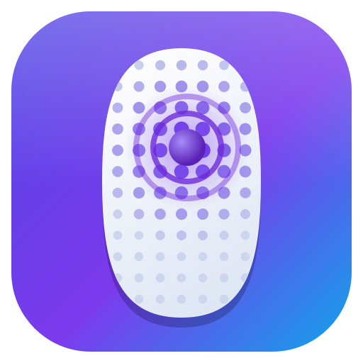

<p align="center"></p>

# MagicMouse Studio

Windows aplikacija za **Apple Magic Mouse 2** (Bluetooth): živi prikaz touch senzora (prsti, elipse, stanja, tragovi),
baterija sa upozorenjima i geste, skrol i tap-za-klik izračunati iz sirovih podataka senzora. Napisana od nule:
mali KMDF filter drajver + Python / PySide6 aplikacija u traci.

[English](README.md) · **Srpski**

> Projekat nije povezan sa kompanijom Apple Inc. niti ga ona podržava. „Magic Mouse“ je zaštićeni znak kompanije Apple Inc.
> Drajver je **test-potpisan** i učitava se samo kad je uključen Windows test režim (vidi [Ograničenja](#ograničenja)).

## Kako radi

```
Magic Mouse 2 ──BT L2CAP──> BTHENUM HID čvor
                             ├─ HidBth (Windows)
                             ├─ applewirelessmouse (Apple Boot Camp: touch ON, skrol)
                             └─ mmsfilter.sys  (naš, NAJNIŽI: samo kopira dolazne pakete)
                                     │  \\.\MagicMouseStudio  (IOCTL: READ_FRAME, GET_STATUS, SET_FEATURE)
                                     ▼
                             app (Python + PySide6): dekoder 0x12/0x90 → prikaz, baterija, geste
```

- Filter ništa ne menja u saobraćaju. Ako se ukloni, miš radi kao pre, preko Apple drajvera.
- Baterija: miš je šalje pri povezivanju i filter je pamti. Na kablu se čita direktno preko USB HID-a.
- RE nalazi o Magic Utilities i Apple drajveru: [docs/RE-izvestaj.md](docs/RE-izvestaj.md).

## Zahtevi

- Windows 10/11 x64, Magic Mouse 2 uparen preko Bluetooth-a.
- Instaliran Apple Boot Camp drajver za miš (`applewirelessmouse`).
- Windows test režim za drajver: `bcdedit /set testsigning on` (kao administrator, Secure Boot isključen), pa restart.

## Instalacija

`MagicMouseStudio-Setup-<verzija>.exe` sa stranice [Releases](../../releases): jedan fajl, oko 22 MB, ne traži Python.
- Instalira u `Program Files\MagicMouse Studio` (.exe + `driver\`) i pravi prečicu u Start meniju, a po želji i na radnoj površini.
- Zadatak „Instaliraj drajver senzora“ pokreće `driver\setup-driver.ps1`. Skripta proverava test režim i pravi ili ažurira servis.
  Zatim skida filter sa USB-a i stavlja ga ispod Apple filtera na BT čvoru. Uređaj se restartuje samo ako je bilo promene.
  Izlazni kodovi: **10** test režim je isključen · **11** nema uparenog miša · **12** nedostaje Apple Boot Camp drajver.
- Jezik čarobnjaka (7 jezika) postaje jezik aplikacije pri prvom pokretanju.
- Deinstalacija (Podešavanja → Aplikacije) uklanja aplikaciju i drajver. Podešavanja u `%LOCALAPPDATA%\MagicMouseStudio` ostaju.

## Pokretanje iz izvornog koda

```powershell
cd app
py -3.14 -m venv .venv
.venv\Scripts\python -m pip install -r requirements.txt
cd ..
.\MagicMouseStudio.cmd
```

`app\mmstudio\mmshook.dll` je već preveden u repozitorijumu. Ponovo se gradi sa `app\native\build.ps1`
(potrebni su VS 2022 Build Tools). Testovi ne traže ni miš ni drajver: `app\tests\test_*.py`.

## Build

- **Drajver:** `driver\build.ps1` koristi VS 2022 Build Tools + WDK 10.0.26100. Drajver test-potpisuje sertifikatom iz `CurrentUser\My`.
- **Instaler:** `installer\build-installer.ps1` redom pravi ikonicu, pokreće testove, pakuje aplikaciju PyInstaller-om,
  proverava potpis drajvera i pravi Setup.exe sa Inno Setup 6.4+/7.
- **Provera spakovane aplikacije:** `MagicMouseStudio.exe --selftest <fajl>` proverava jezike, hook DLL, ikonicu, drajver
  i svih 9 stranica, a ulaz i podešavanja ne dira.

| Skripta (admin) | Šta radi |
|---|---|
| `driver\setup-driver.ps1` | sve u jednom koraku: provera test režima, servis, fajl, filteri (koristi ga instaler) |
| `driver\install-bt.ps1` | servis `mmsfilter` + `LowerFilters = {mmsfilter, applewirelessmouse}` na BT mišu |
| `driver\update.ps1` | učitava novi build (isključi → zameni → uključi uređaj) |
| `driver\uninstall.ps1` | potpuno uklanjanje (filteri, servis, fajl) |

## Struktura

- `app\mmstudio\protocol.py`: MM2 format (touch 0x12, baterija 0x90); testovi su u `app\tests`.
- `app\mmstudio\hid.py`: HID preko ctypes, bez dodatnih paketa.
- `app\mmstudio\driverlink.py`: veza sa `mmsfilter.sys`.
- `app\mmstudio\engine.py`: pozadinsko čitanje, baterija BT/USB, watchdog.
- `app\mmstudio\inputengine.py` + `hook.py` + `winput.py`: skrol, tap, geste; low-level hook i nit za ubacivanje ulaza.
- `app\mmstudio\ui\`: prozor, prikaz miša, tray.
- `app\tools\`:
  - `capture.py`: snimanje sirovih frame-ova;
  - `stress_replay.py`: test bez miša;
  - `translations.py`: tabela prevoda;
  - `make_icon.py`: ikonica.

## Jezici

7 jezika: English (podrazumevano), Srpski, Español, Português (Brasil), Français, 中文（简体）, العربية (prikaz zdesna nalevo).
- Tekstovi u kodu su na engleskom i idu kroz `_()` (`app\mmstudio\i18n.py`).
- Glavna tabela prevoda je `app\tools\translations.py`. Ona generiše `app\mmstudio\locales\<kod>.json`.
- `app\tests\test_i18n.py` proverava da svaki tekst postoji u svim jezicima sa istim `{zamenama}`.

## Podešavanja

Isti set kao u Magic Utilities. Stranice: Pregled · Skrolovanje · Klikovi · Tap za klik · Geste · Zone · Baterija · Aplikacija · Napredno.
U `app\mmstudio\settings.py` svako polje navodi ime odgovarajućeg MU podešavanja (npr. `usScrollingInverseVerti`, `esTapDelay`).

Kako se primenjuju:
- **Računanje i ubacivanje:** skrol, tap, potezi i geste računaju se iz sirovih frame-ova senzora i ubacuju preko `SendInput` iz posebne niti.
- **Hook:** low-level hook (`mmshook.dll`) guta Apple-ov točkić i klik **samo** dok je prst na Apple mišu, pa se drugi miš ne dira.
  Hook nikad ne poziva `SendInput` iz same hook procedure, jer bi to izazvalo deadlock celog sistemskog ulaza.
- **Povratak na Apple:** opcija „Skrol/Klik obrađuje: Apple drajver“ vraća originalno ponašanje. U traci je i „Pauziraj geste i skrol“.

## Ograničenja

- **Test potpis:** drajver je potpisan test-sertifikatom. Za rad bez test režima treba EV sertifikat i Microsoft potpis.
- **Setup.exe:** nije potpisan, pa SmartScreen može da upozori.
- **Brzina pokazivača:** po uređaju još nije urađena; za to su skrol i brzina potrebni u samom drajveru.
- **USB:** preko USB-a Magic Mouse 2 šalje samo bateriju, nikad dodir.

## Licenca

[MIT](LICENSE)
